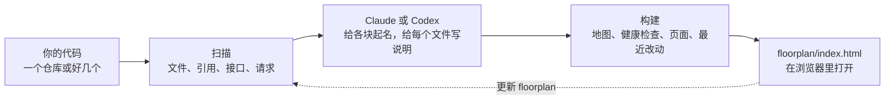

<div align="center">

<picture>
  <source media="(prefers-color-scheme: dark)" srcset="docs/images/logo-dark.png">
  
</picture>

# Floorplan

本项目基于 [haydenschmitty/floorplan](https://github.com/haydenschmitty/floorplan) 进行中文本土化适配。原作者是 [Hayden Smith](https://github.com/haydenschmitty)。这不是一份新写的软件，安装请用下面的 `Aondle/floorplan`，装到的才是中文版。

**看看你的应用到底是怎么拼在一起的。**

Claude 或 Codex 会读你的项目，画出一张能点开的地图。每一块、每个文件、每种网页请求都有一句人话名字，它们之间怎么连，也画在上面。

[](https://code.claude.com/docs/en/overview)
[](docs/codex.md)
[](https://github.com/haydenschmitty/floorplan/actions/workflows/test.yml)
[](CHANGELOG.md)
[](LICENSE)
[](https://nodejs.org)
[](#how-it-works)

<a href="https://trendshift.io/repositories/322616"></a>

**[打开在线演示](https://haydenschmitty.github.io/floorplan-demo/)** · [看视频](https://youtu.be/NTUUzC7L_NQ) · [安装](#install) · [三分钟上手](#quick-start) · [和别的工具比](#floorplan-archify-or-understand-anything) · [能做什么](#features) · [实际长什么样](#see-it-in-action) · [它怎么干活](#how-it-works) · [文档](docs/README.md) · [常见问题](#faq)

</div>

<p align="center">
  <a href="https://youtu.be/NTUUzC7L_NQ"></a>
</p>
<p align="center"><sub>▶ <a href="https://youtu.be/NTUUzC7L_NQ">看演示</a>：先装上 Floorplan，再逛一遍 Brewline 的地图。Brewline 是一个演示用的咖啡订阅应用，代码分在四个仓库里。</sub></p>
<p align="center"><b><a href="https://haydenschmitty.github.io/floorplan-demo/">打开在线演示 →</a></b> 在浏览器里逛 Brewline 的地图，不用安装。演示站和视频仍是上游原作者的。</p>

<a id="why"></a>

## 为什么要用 Floorplan？

你做了一个应用，多半是 AI 帮了大忙，而且它能跑。可一问「有人结账时发生了什么」或者「我改这里会弄坏什么」，老实话是：*不知道*。

Floorplan 补上那张没人画过的图。跟 Claude Code 或 Codex 说一声要 floorplan，几分钟后你就有一张能逛、能问、跟着你改代码一起更新的地图。

- **给自己做东西的人：** 用你听得懂的话看懂这个应用，不用去读代码。
- **给团队：** 新人几分钟就能从大局看到具体是哪个文件。
- **给跟 AI 一起干活的人：** Claude 或 Codex 每改一处，你能看见动了哪几块、为什么动。

<a id="floorplan-archify-or-understand-anything"></a>

## Floorplan、Archify，还是 Understand Anything？

三个都能把代码变成看得见的东西，都值得知道。它们回答的问题不一样：

| | **Floorplan** | **[Archify](https://github.com/tt-a1i/archify)** | **[Understand Anything](https://github.com/Egonex-AI/Understand-Anything)** |
|---|---|---|---|
| **它回答的问题** | 我做的这个应用实际上怎么运转，我该担心什么？ | 我怎么把这个讲清楚？ | 这一大摊代码怎么工作，细到每个函数？ |
| **给谁用** | 用 AI 做东西、自己不读代码的人 | 谁要讲一个系统、一个流程或一个想法 | 要摸清一个大代码库的开发者 |
| **你得到什么** | 整张应用可以缩放的地图：各块、文件和接口（服务器答应应答的一种网址）、页面、页面和服务器之间的请求（仓库分开也行），以及外面的服务 | 十种图里选一种，画得整齐（架构图、时序图、表关系图……），或从仓库、甚至从一段描述做出一页说明 | 每个文件、函数、类的知识图谱，带分层、业务域视图和导览 |
| **只有它有** | **健康检查**（密钥写在代码里、谁都能读的 Supabase 表和 Firebase 规则、能伪造的 Stripe 到账通知、谁都能调用的接口）、**最近改动**（AI 刚改了什么、为什么）、从需求文档画出的规划蓝图 | 十种图、导出图片和视频、不是代码的东西也能画 | 改动影响、按你的角色变的看板、知识库图谱 |
| **跑在哪** | Claude Code、Codex | Claude Code、Codex、Cursor、OpenCode 等 | Claude Code、Codex、Cursor、Copilot、Gemini CLI 等 |

**选 Floorplan**，是为了看懂并检查一个你自己拥有的应用。**选 Archify**，是为了给文档、分享或拍板画一张图。**选 Understand Anything**，是为了一个函数一个函数地研究大代码库。

也可以一起用：先用 Floorplan 把应用画出来，再用 Archify 抽出一条流程去做演示。

<a id="features"></a>

## 能做什么

<table>
<tr>
<td width="50%" valign="top">

**🗺️ 每一层都能看**<br>
先看整个应用，再双击进一块、一组文件、一个文件，以及它的接口。每一层都标着谁在用它、它在用谁。

</td>
<td width="50%" valign="top">

**💬 到处都是人话**<br>
写「结账时刷卡收款」，不写「Stripe API 包装」。术语鼠标停上去会解释。有一个开关可以换成开发者看法。

</td>
</tr>
<tr>
<td valign="top">

**🔌 真的连上了，仓库分开也行**<br>
它顺着代码里的引用走，并把页面前端发出的每个网页请求对上应答它的服务器接口，仓库不在一起也能对上。

</td>
<td valign="top">

**🖥️ 从一个你认识的页面看起**<br>
选一个你知道的页面，看它背后的一切：里面有什么、它发出哪些请求、服务器上的代码、数据，以及外面的服务。

</td>
</tr>
<tr>
<td valign="top">

**🧭 向地图提问**<br>
「退款怎么回到顾客的卡上？」会得到一段回答，加上只含相关几块的小地图，还有一步一步的讲解。

</td>
<td valign="top">

**🩺 健康检查**<br>
抓住 AI 做出来的应用里那些老毛病：密钥写在代码里或发给了浏览器、谁都能读的 Supabase 表、敞开的 Firebase 规则、谁都能伪造的 Stripe 到账通知、没人登录也能用的接口。每条都附一段可以直接贴走的改法。这是一次检查，不是安全审计。

</td>
</tr>
<tr>
<td valign="top">

**🟢 最近改动**<br>
AI 刚改过的卡片会亮成绿色，每张都写着这次改动是怎么对着你的要求来的。

</td>
<td valign="top">

**⚡ 跟着变，而且还是你的**<br>
更新时只重读有变化的部分，已经打开的地图会自己刷新。全部在你自己的电脑上跑，不会提交进 git。

</td>
</tr>
</table>

另外还有：用大白话就能请它串起来的**流程**、一分钟的**新手导览**、把地图收成一个 HTML 文件就能发给别人的**导出**、手机和平板上能拖、能捏合缩放的布局、搜索、键盘快捷键，以及每张卡片上的右键菜单。

<a id="also-blueprints-for-apps-you-havent-built-yet"></a>

### 还有：代码还没写，也可以先画规划蓝图

Floorplan 主要是给已经有的代码画地图。它也可以从一份 PRD（产品需求文档，写清楚要做什么）、规格或一段描述出发，画出一张**规划蓝图**：同样的地图，标出将来需要的每一块、每个文件、每个接口和每个页面，以及它们怎么拼。卡片是虚线，表示这还是计划。健康检查换成对计划还没定下来的事的审查，每一块都有一段现成的「请帮我做这块」的请求，你也可以在地图上改计划（「把退款也规划进去」）。代码写出来之后，蓝图就变成真实代码的地图。见[还没写代码，先画一张规划](docs/getting-started.md#plan-something-you-havent-built-yet)。

<a id="see-it-in-action"></a>

## 实际长什么样

想自己点一点？打开[在线演示](https://haydenschmitty.github.io/floorplan-demo/)：一边是真实的 Brewline 地图，一边是写好的对话，Claude Code 和 Codex 里都能看。演示站是上游原作者放的。

<table>
<tr>
<td width="50%" valign="top">

<p><b>向地图提问。</b> 这是 Claude Code 命令行里 31 秒给出的真实回答。它跨两个仓库，把礼物从表单追到收件箱，路上还发现了两个毛病。</p>
</td>
<td width="50%" valign="top">

<p><b>从一个页面看起。</b> 任选一页，从按钮一直看到数据库和外面的服务。</p>
</td>
</tr>
<tr>
<td valign="top">

<p><b>最近改动。</b> 你要求了什么、改了什么、为什么要改，都在一块板上。</p>
</td>
<td valign="top">

<p><b>健康检查。</b> 留在代码里的密码，和谁都能调用的接口，每条都能一键复制改法。</p>
</td>
</tr>
<tr>
<td valign="top">

<p><b>放大看。</b> 任一块里面有什么、谁在用它、它靠什么。绿色标签标出刚改过的。</p>
</td>
<td valign="top">

<p><b>引导流程。</b> 看一个请求在应用里一步一步怎么走，或者请它再追一条新的。</p>
</td>
</tr>
</table>

<a id="install"></a>

## 安装

你需要 [Node.js 18 或更新](https://nodejs.org)（跑 Floorplan 自带脚本的运行环境），以及 Claude Code 或 Codex 里的一个。Floorplan 用你已经有的套餐，不用另外配 API 密钥。

给人复制的命令指向这份中文版：`Aondle/floorplan`。插件名仍是 `floorplan`。上游仓库 [haydenschmitty/floorplan](https://github.com/haydenschmitty/floorplan) 是出处，从那里安装会得到英文原版。

### Claude Code

Claude Code 是 Anthropic 的编程助手，能在你电脑上读项目。在桌面应用的 Code 标签页，或在命令行里：

```bash
claude plugin marketplace add Aondle/floorplan
claude plugin install floorplan@floorplan
```

第一行把这份仓库登记成插件来源（marketplace，就是「去哪个仓库找插件」）。第二行安装，插件名是 `floorplan`。

**新开一轮对话**之后就能用。就算你主要用桌面应用，也建议装上 Claude Code 命令行：有了它，地图的提问栏才能去读你的真实代码。详见[上手](docs/getting-started.md)。

### Codex

Codex 是 OpenAI 的编程助手，用 ChatGPT 账号登录。不用打开终端：

1. 在 Codex 应用里打开 **Plugins**，选 **Add a marketplace**。
2. **Source** 填 `Aondle/floorplan`，点 **Add marketplace**。
3. 找到 **Floorplan**，点 **+** 安装。

或者在终端里：

```bash
codex plugin marketplace add Aondle/floorplan
codex plugin add floorplan@floorplan
```

新开一个聊天，说要一张 floorplan，或输入 `$floorplan`。地图的提问栏用的是你自己的 Codex 登录，不用 API 密钥。详见[在 Codex 里用 Floorplan](docs/codex.md)。

<a id="quick-start"></a>

## 三分钟上手

1. 用 Claude Code 或 Codex 打开你的项目。页面和服务器分在不同仓库时，打开那个把它们都放在里面的文件夹。
2. 说：
   > 给这个应用画一张 floorplan。

   （在 Codex 里也可以输入 `$floorplan`。）
3. 逛一逛。地图会自己打开，并先带你做一段短导览。

之后又改过代码，就说：

> 更新 floorplan。

只有变过的部分会重读。你刚动过的，会在 **最近改动** 里亮起来。

**还没有代码？** Floorplan 也可以按 PRD 或规格来规划一个应用。把文档给它，然后说：

> 这是我的 PRD。画一张 floorplan，看看我们要做些什么。

你会得到一张[规划蓝图](#also-blueprints-for-apps-you-havent-built-yet)，清清楚楚标成「还是计划」。

### 可以试试这些

| 对 Claude Code 或 Codex 说 | 对地图说 |
|---|---|
| 「给这个应用画一张 floorplan」 | 「有人下单之后发生了什么？」 |
| 「更新 floorplan」 | 「我们在哪里跟 Stripe 说话？」 |
| 「把 floorplan 健康检查里要紧的问题改掉」 | 「我要是改用户表，哪里会坏？」 |
| 「加一条流程，看看新用户怎么注册」 | 「哪些文件在管登录？」 |
| 「把 floorplan 改成给开发者看的」 | 「为了退款我们改了什么？」 |
| 「导出 floorplan，我好发给团队」 | |

<a id="how-it-works"></a>

## 它怎么干活



脚本干机械的活：找仓库、解析十几种语言的代码、把网页请求对上接口、把地图摆开。它们是不带第三方依赖的普通 Node 脚本。Claude 或 Codex 干只有读过代码的人才能干的那部分：判断你的应用*有哪些块*，并用大白话说出来。细节见[它怎么干活](docs/how-it-works.md)。

**语言：** TypeScript、JavaScript、Python、Go、Rust、Java、Kotlin、Scala、Swift、C#、PHP，外加 Vue、Svelte、Astro 文件和 Shopify 主题（Liquid）。其他语言也能扫，只是没这么细。<br>
**接口：** Express、Fastify、Koa、Hono、NestJS、Next.js、Firebase Cloud Functions、Supabase Edge Functions、Flask、FastAPI、Django、Go 的 net/http、Gin、Echo、chi、Actix、Axum、Spring、ASP.NET Core、Laravel（含 Wayfinder 调用）、Serverless Framework（`serverless.yml`）、`Bun.serve` 的路由，以及按方法和路径当键的路由表（JavaScript 和 Python 里的 `"GET /api/orders": listOrders`，或 JavaScript 里写成 `{ method, path, handle }` 的列表）。<br>
**页面：** Next.js、React Router、Vue、SvelteKit、Remix、Nuxt、Astro、Expo、Angular、TanStack、Shopify 主题、Inertia。

## 它会往你的项目里放什么

一个 `floorplan/` 文件夹，里面是地图。在 Claude Code 里，如果你点头，它还会往 `CLAUDE.local.md` 加一小段，让以后的对话知道地图在哪。**这两样都不会提交：** 这个文件夹自己让 git 忽略它，`CLAUDE.local.md` 写进你这份克隆的私人忽略名单。在 Codex 里只加 `floorplan/` 文件夹。你的 `.gitignore` 和其他已经被 git 跟踪的文件，一概不动。见[项目里有什么](docs/project-files.md)。

## 隐私

- 扫描、地图和那个小小的本地服务器都在你的电脑上跑。服务器只接受从你这台机器来的连接。
- 没有第三方依赖，也没有安装脚本。地图离线也能用：排版引擎和字体都做在文件里。
- 在地图上提问，走的是你自己的账号，经过 Claude Code 命令行或 Codex。它们能读你的代码，不能改。
- 健康检查不保存、也不显示密钥的值，只说它在哪。
- 没有统计，也没有追踪。地图可能会问一次：Floorplan Cloud 上线时要不要发邮件给你。你不报名，什么都不会发出去；报名也只发你的邮箱，以及「就我自己」还是「和团队一起」。

更多见[隐私与安全](docs/privacy-and-security.md)。装一个插件放不放心？[装上安全吗？](docs/is-it-safe.md) 列出 Floorplan 在你电脑上会做的每一件事、每次改动怎么用测试盯着，以及怎么核对你装到的那一份。

## 文档

| | |
|---|---|
| [上手](docs/getting-started.md) | 安装、第一张地图、更新、按 PRD 做规划、卸掉 |
| [在 Codex 里用](docs/codex.md) | 在 Codex 里安装和使用 |
| [用地图](docs/using-the-map.md) | 每个按钮、每种看法、快捷键和菜单 |
| [它怎么干活](docs/how-it-works.md) | 流水线、请求怎么对上接口、更新怎么省事 |
| [项目里有什么](docs/project-files.md) | Floorplan 创建的每个文件，以及怎么改 |
| [隐私与安全](docs/privacy-and-security.md) | 什么在哪跑，什么会离开你的电脑 |
| [装上安全吗？](docs/is-it-safe.md) | 没有挂钩、没有 MCP 服务器、没有依赖、也不会下载；它会启动哪些程序；怎么核对你装到的那一份 |
| [遇到问题](docs/troubleshooting.md) | 常见问题和改法 |
| [不在对话里跑](docs/unattended.md) | 在自动检查、脚本或你自己的工具里跑，换任何模型都行 |
| [开发 Floorplan](docs/development.md) | 仓库怎么排、本地安装、怎么发布 |

<a id="faq"></a>

## 常见问题

<details>
<summary><b>装上安全吗？</b></summary>

Floorplan 没有挂钩（hooks，会话里一有事件就自动跑的脚本），没有 MCP 服务器（给 AI 接外部工具的一种插件），没有第三方依赖，什么都不下载，也从不运行网上来的代码。它唯一对外的请求是你自愿加入的候补名单。每次改动都有测试盯着这些，每次发布还列出每个文件的指纹，你可以核对装到的是不是这一份。全写在[装上安全吗？](docs/is-it-safe.md)。
</details>

<details>
<summary><b>我的代码会离开这台电脑吗？</b></summary>

只会按 Claude Code 和 Codex 本来的方式：AI 通过你自己的账号，读它为了描述你的应用而需要的文件。地图本身是本地文件，它的服务器只听你这台机器。如果你改成在 Claude 应用里打开地图，Claude 会先问你，再把地图（名字、说明和结构，不是你的源代码）上传到你私人的 claude.ai 账号。Floorplan 自己会发出去的，只有你的邮箱，而且只有你报名[Floorplan Cloud 候补名单](docs/privacy-and-security.md#floorplan-cloud-waitlist)时才会发。
</details>

<details>
<summary><b>要多久，要花多少？</b></summary>

第一张地图，小应用几分钟，大的更久，因为每个文件和每个接口都要写说明。它像别的任务一样，用你的 Claude 或 ChatGPT 套餐。大项目会拆给几个帮手并行做。更新只重读有变化的部分，所以又快又省。
</details>

<details>
<summary><b>提问栏一定要装命令行吗？</b></summary>

不用。没有命令行，地图照样能看。提问栏是通过 Claude Code 命令行或 Codex 来回答的，这样才能读你的真实代码。Codex 的桌面应用已经带了它需要的东西。用 Claude 时，如果没装命令行，可以改到 Claude 应用里问，那时只根据地图回答。
</details>

<details>
<summary><b>它会改我的文件，或帮我提交吗？</b></summary>

它只写自己的 `floorplan/` 文件夹（在 Claude Code 里，如果你点头，还会改 `CLAUDE.local.md` 里的一段）。这两样都不会提交。它从不改你的代码、你的 `.gitignore` 或你的 `CLAUDE.md`。
</details>

<details>
<summary><b>它起的名字不是我们平时的叫法。能改吗？</b></summary>

能。直接说（「把 floorplan 上的『主服务器』改成『商店接口』」），或自己改 `floorplan/architecture.json` 和 `floorplan/descriptions/`。你改过的，每次更新都会留着。
</details>

<details>
<summary><b>Codex 和 Claude Code 都能用吗？</b></summary>

能。同一个插件、同一张地图、同一套健康检查。各自用你自己的套餐：Claude Code 用 Claude 账号，Codex 用 ChatGPT 登录。在一边做的地图，另一边打开也行。见[在 Codex 里用 Floorplan](docs/codex.md)。
</details>

<details>
<summary><b>代码还没写，能用吗？</b></summary>

能，不过它主要还是给已有的代码画地图。把 PRD、规格或一段对应用的描述给它，说要一张 floorplan，你就得到一张规划蓝图：要做些什么的地图，标成计划，并审查还有哪些决定没定。你可以在地图上改它，代码做出来后再换成真实代码的地图。见[还没写代码，先画一张规划](docs/getting-started.md#plan-something-you-havent-built-yet)。
</details>

<details>
<summary><b>一个仓库里有很多项目，或多个仓库并排放，行吗？</b></summary>

行。可以指一个大仓库（monorepo，一个仓库里放好几个子项目）、它的一个子文件夹，或一个普通文件夹里并排放着好几个仓库。它会把每个仓库都找出来，再把它们连上。
</details>

<details>
<summary><b>这和 Archify 或 Understand Anything 有什么不同？</b></summary>

Archify 什么都能画成图。Understand Anything 给开发者做代码库的知识图谱。Floorplan 用大白话画出你做的应用，并告诉你哪里有风险、AI 刚改了什么。见[Floorplan、Archify，还是 Understand Anything？](#floorplan-archify-or-understand-anything)
</details>

## 星标走势

上游仓库的星标，留在这里说明出处：

<a href="https://star-history.com/#haydenschmitty/floorplan&Date">
  <picture>
    <source media="(prefers-color-scheme: dark)" srcset="https://api.star-history.com/svg?repos=haydenschmitty/floorplan&type=Date&theme=dark">
    
  </picture>
</a>

## 参与

欢迎提问题和拉取请求。见 [CONTRIBUTING.md](CONTRIBUTING.md) 和[开发 Floorplan](docs/development.md)。

## 许可证

[MIT](LICENSE) © 2026 [Hayden Smith](https://github.com/haydenschmitty)
