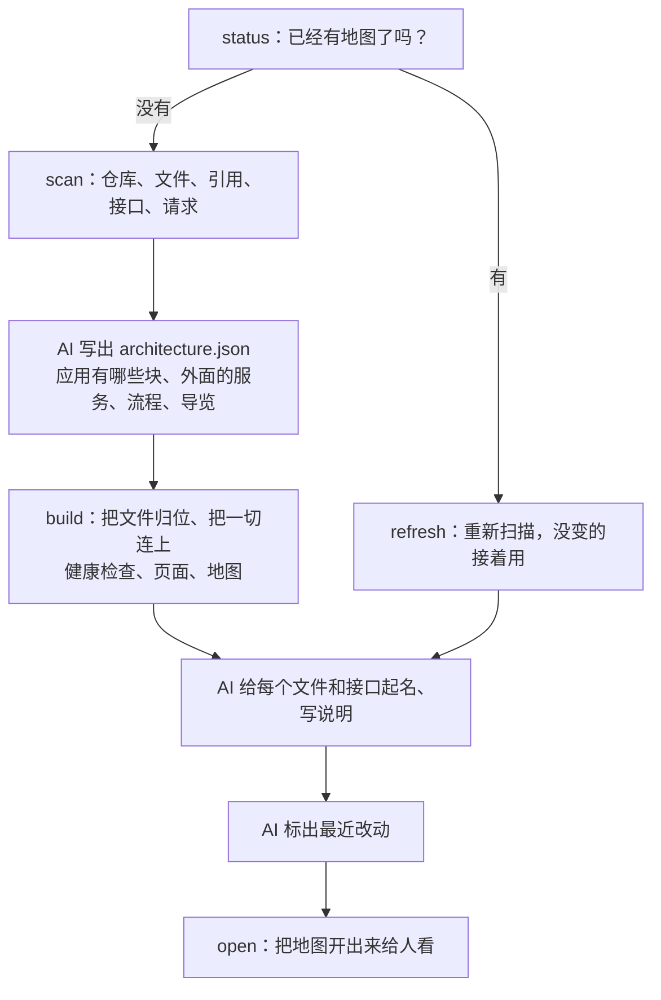

# 它怎么干活

Floorplan 把活分给脚本，和你跑它的那个 AI（Claude Code 或 Codex）。脚本干一切机械的事：找文件、解析代码、把请求对上接口、把地图摆开。它们是不带第三方依赖的普通 Node.js，不花 AI 用量。AI 干只有读过代码的人才能干的事：判断你的应用*有哪些块*，并用大白话讲清楚。

## 1. 扫描

`scan.mjs` 在你指给它的文件夹下面找出每一个 git 仓库（一个仓库、一个大仓库，或并排放着的好几个），并跳过重复的工作树。它用 git 列文件，所以你的 `.gitignore` 会得到尊重。然后从每个文件里抽出：

- **引用**，解析到真实文件：TypeScript 的路径别名（包括通过 `extends` 继承来的）、package.json 的 `"imports"`（`#lib/x`）、Python 包、Go 模块、Rust crate、JVM 包（Kotlin 和 Java 里，一个文件从自己的包里用不需要 import 的那些名字也算）；
- 在 **Nuxt** 应用里，一个文件没用 import 就用到的组件和组合函数（Nuxt 的自动导入），按名字对上。应用构建或启动过一次之后，扫描只读 Nuxt 写出的两份名单，`.nuxt/components.d.ts` 和 `.nuxt/imports.d.ts`；否则就按 Nuxt 的文件夹习惯来（`components/`，文件夹名当前缀，以及 `composables/` 和 `utils/`）。`.nuxt/` 里别的都不读，它也从不成为地图的一部分；
- **导出的定义**和它们的文档注释；
- 服务器定义的**接口**；
- 代码发出的**网页请求**；
- 内容**指纹**，好让以后的更新看出什么变了。

支持的语言：TypeScript 和 JavaScript（包括 Vue、Svelte、Astro 文件）、Python、Go、Rust、Java、Kotlin、Scala、Swift、C#、Groovy 和 PHP，以及 Shopify 主题（Liquid）。其他语言也能扫，只是没这么细。PHP 文件会连到它们用到的类：`use` 语句，以及文件没写 `use` 就点名的类（`new Order`、`Order::class`、参数类型），按命名空间找，也通过 `composer.json` 里的 PSR-4 文件夹找。PHP 只读，从不运行。

**Shopify 主题。** 有 `layout/theme.liquid` 的文件夹按主题来读。它的文件靠名字互相找到，不靠路径，所以 Floorplan 把 `` 对上 `snippets/price.liquid`，把 `` 和 `` 对上 `sections/`，把 `` 对上 `blocks/`，把 `'theme.js' | asset_url` 对上 `assets/`。JSON 模板和分区组用它们列出的分区和主题块，包括打进模板自定义代码设置里的 Liquid。以应用块或应用嵌入加进来的应用，显示成外面的包，名字是 `shopify-app:<应用>`。注释和 `` 的例子会跳过。一个片段没有任何东西渲染它、也没有任何别的文件点它的名字，健康检查会把它列成没人用；布局、模板、分区和主题块从不这样，因为 Shopify 按名字加载它们。主题的 Liquid 文件和 JSON 模板算代码，所以它们在地图上，不在 `NOT MAPPED` 下面。`NOT MAPPED` 是扫描和构建打印的固定英文行，表示没画进地图的那几类文件。主题以外，`.liquid` 文件和 `templates/*.json` 仍按原来的方式处理。

## 2. 把请求对上接口

地图上最有用的线，把一个页面的网页请求连到应答它的服务器代码，经常跨仓库。Floorplan：

- **找接口**，在这些地方：Express、Fastify（含插件前缀）、Koa、Hono、NestJS（控制器上的装饰器）、Next.js（路由文件和 API 路由）、Firebase Cloud Functions、Flask、FastAPI、Django、Go（net/http、Gin、Echo、chi、Fiber）、Actix、Axum、Spring 和 ASP.NET Core（特性路由的控制器、`MapControllerRoute` 的约定路由、最小 API 和 SignalR 枢纽），以及路由表：JavaScript 和 Python 里按方法和路径当键（`"GET /api/orders": listOrders`），JavaScript 里写成 `{ method, path, handle }` 的对象列表（路径可以是正则），还有 `Bun.serve({ routes })`。
- **把前缀补全**：Flask 用 `url_prefix` 登记的蓝图；Express 和 Hono 用 `app.use('/api/users', usersRouter)` 或 `app.route('/api', api)` 挂上的路由器，不管路由器叫什么名字，包括挂在别的路由器里面的（同一个文件或另一个文件）、由索引文件转交的（`export { default as authRoutes } from './auth.routes.js'`）、由函数做出来的（`app.use('/billing', createBillingRoutes())`），以及前面放了中间件的挂载；ASP.NET Core 控制器上的 `[Route]` 前缀（子类继承来的动作用子类的前缀）和最小 API 上的 `MapGroup` 前缀，包括从另一个文件调用的、用来登记接口的扩展方法所在的组。
- **找请求**，用 `fetch`、axios、ky、`requests`、SignalR 的 `withUrl(…)` 以及类似的发出的，包括：
  - 地址先放进变量：`const url = …; api.get(url)`；
  - 带嵌套部分的模板字符串；
  - 同一个文件里加前缀的小帮手，比如 `call('/definitions')`；
  - 应用自己的请求帮手，比如 `apiGet('/tasks')` 或 `` apiSend('PATCH', `/tasks/${id}`, body) ``，方法从名字或第一个参数来；
  - 服务类里拼地址的方法，比如 `this.http.post(this.url(id, '/ship'), body)`（Angular 的服务以及类似的），包括一个方法建立在另一个之上；
  - 地址在下一行的调用，比如 `this.http.patch<Order>(` 后面跟模板字符串；
  - 方法写在地址下面几行的选项里，比如 ``fetch(`/api/users/${id}`, {``，下面是 `method: "PATCH"`。
- **Laravel** 的路由来自 `Route::get(…)`、`match`、`resource` 和 `apiResource`（带 `only` 和 `except`）、`Route::view` 和 `Route::inertia`，在前缀、名字、中间件和控制器组下面，链式写法和较老的 `Route::group([...])` 都认。一个路由文件在组里面被加载（`require __DIR__.'/admin.php'`、`->group(base_path('routes/admin.php'))`、在固定名单上循环 `require` 的文件，以及 `bootstrap/app.php` 里的 `withRouting`），会得到那个组的前缀、名字和中间件。由控制器方法应答的接口，坐在控制器的文件里、那个方法上；闭包留在它写下的地方。只有把应用跑起来才看得出来的路由（从数据循环建出来，或由一个包登记的）找不到。
  - **Wayfinder** 调用（`import { show } from '@/routes/orders'`，以及来自 `@/actions/…` 的 `OrderController.update.form(…)`）按路由名或控制器方法找到接口，尽管 Wayfinder 生成的文件不在 git 里。
  - **Inertia** 页面：一个控制器方法渲染一页（`Inertia::render('orders/show')`），会让那一页成为接口地址上的一个页面，并连到提供它的控制器。
- **Serverless Framework** 的接口写在 `serverless.yml`（以及 `serverless-*.yml`）里，不写在代码里：每个函数的 `http` 和 `httpApi` 事件给出地址，包括用 `${file(./functions.yml)}` 拆到多个文件里的函数名单。接口坐在它的 `handler:` 点名的那个文件里，或者坐在那个处理函数只是把请求转交给的函数里。健康检查把 `authorizer` 或 `private: true`（一把 API 密钥）当成登录检查。测试文件夹里的配置不算。
- **Supabase Edge Functions**：`supabase/functions/` 下面的每个文件夹（`_shared` 和其他以 `_` 开头的除外）是 `/functions/v1/<名字>` 上的一个接口，任何方法都行，在它的 `index.ts` 里。一个函数自己跑一个路由器（Hono 以及类似的），就改成那个路由器的接口，仍在 `/functions/v1` 下面。网站的 `supabase.functions.invoke('<名字>')` 调用（除非选项另说，否则是 POST）和对 `…/functions/v1/<名字>` 的请求会找到它们。健康检查按每个函数自己的代码来判断，不管 `verify_jwt` 怎么说，因为网站带着的那把公开的 anon 密钥过得了那一关。
- **普通 PHP 站点**，没有框架路由：文档根（`public/`、`public_html/`、`www/` 或 `htdocs/`）下面的每个脚本在它自己的地址上应答（`public/orders/save.php` 在 `/orders/save.php`，一个 `index.php` 在它所在文件夹的地址上）。别的脚本 include 进来的脚本，以及 `_` 或点开头的文件夹里的文件，是页面的零件，不是页面。文档根的 `index.php` 如果加载了 Composer 的自动加载器，那是框架的前门控制器（Laravel、Symfony、Slim），留给框架的路由去处理。
- **Firebase Cloud Functions** 按名字调用，不按地址。一个可调用函数（`onCall`）显示成 `CALL /approveItem`，名字是你的函数入口文件导出它时用的那个。网站的 `httpsCallable(functions, 'approveItem')` 调用会找到它，包括你自己包了一层 `httpsCallable` 的帮手。一个 `onRequest` 函数是 `/<名字>` 上的普通接口，传给它的 Express 应用保留自己的路由，挂在那个名字下面。定时的和其他后台函数（Firestore、Storage、Pub/Sub）列给 AI，由它放到地图上。
- **把两边对上**。ASP.NET Core 忽略大小写，因为它的路由就是这样。一个请求只写出地址的一部分，因为基址在设置里时，Floorplan 从「只有一个接口能应答」的那些调用来学每个客户端的基路径（在那个客户端自己的文件之间共享，直到它的 package.json 所在的文件夹或它的仓库，从不跟旁边的另一个应用共享），并优先要对得上这个基路径的匹配，哪怕别处有一个更短、看起来更近的地址。

这是按模式匹配，不是编译器，所以大多数连线能抓住，但不是全部。缺了一条要紧的线，就让它加到 floorplan 上，它会记成一条明确的连线。

## 3. AI 描述这个系统

Claude 或 Codex 读扫描摘要、README、配置和入口，然后写出 `architecture.json`：

- 你的应用的主要部分，每一块有一句人话摘要；
- 它真的在跟哪些外面的服务说话（数据库、收款、邮件）；
- 扫描看不见的连线，比如队列、定时任务和到账通知；
- 几条引导流程，和一段「新手导览」。

然后构建把每个文件分给匹配得最深的那一块，并报告剩下没分进去的。

接下来，`describe.mjs` 给每一块写一张工作表。工作表是每个文件和每个接口的摘要：它定义了什么、文档注释、它用什么，以及哪些文件引用它、向它发网页请求，或按名字提到它（所以一个从 `package.json` 启动的脚本，能看出是谁启动的）。它还引用每个接口的代码，以及很短的文件的全文，每个几行，一张工作表最多 120 行，好让 AI 看出某样东西还是占位（「回复 OK，什么都不留」），而不是照名字猜。这些引用里可能是密钥的值会打码，`.env` 这类设置文件从不引用。AI 给每一项填上名字和说明，写代码今天在做的事。大项目上，Claude Code 把工作表拆给几个帮手并行做。

工作表开头那句固定英文是 `Say what it does today`（在 `references/writing-descriptions.md` 里），意思是写它今天真正做的事。给所有人看的地图上，如果名字或说明用了开发者才懂的词，构建会打出以 `plain language:` 开头的提醒（这也是程序里的固定字），并指向那份指南里标题仍为 **Jargon → plain** 的对照表，左列仍是英文词。

默认一切都写给应用的主人，不是工程师：每样东西对事情有什么用，用日常的话。你要一张给开发者看的地图，它就换成技术写法。

## 4. 构建

`build.mjs` 校验 AI 写的一切，并按名字报告问题（「你是不是想写……」）。给所有人看的地图上，某一块的名字或摘要用了开发者才懂的词（「API client」、「UI kit」、某个框架的名字），或者一块里有很多文件、各自待在自己的文件夹里，它也会警告，好让 AI 改写或拆开。然后它：

- 把各块连上，用引用、对上的请求，以及 AI 明确写下的连线；
- 跑 **健康检查**；
- 认出 **页面**：Next.js、React Router、Vue、SvelteKit、Remix、Nuxt、Astro、Expo、Angular、TanStack，以及 Shopify 主题的模板（一份备用模板比如 `product.preorder.json` 是 `/products/:handle?view=preorder`）；
- 写出 `graph.json` 和自包含的 `index.html`，并记下是 Claude Code 还是 Codex 做的，好让地图的提问栏和修复请求点对名字。

地图在你的浏览器里用 [ELK](https://eclipse.dev/elk/) 自己排版，所以构建本身很快。

## 5. 最近改动

每次做完或更新之后，AI 把刚做的事记在 `recent-work.json`。`recent.mjs` 列出事实：上次地图之后改了什么、还没提交的改动、最近的提交，每一项对上它的卡片。AI 补上*为什么*：你要求了什么，每次改动怎么对着这个要求来。上一次的高亮每次都会换掉。

## 6. 打开它

`open.mjs` 在后台启动地图那个小小的本地服务器，并打开你的浏览器。这张地图的服务器已经在跑，就接着用，已经打开的标签页就地刷新，不再新开一个。

## 更新

`refresh.mjs` 重新扫描，并跟上一次的构建比，用每个文件的指纹：

- **内容本身**，能看出编辑、改名和移动；
- **签名**：它的导出、接口和文档注释。函数体里面的修改不算。

然后它：

- 把说明带到移动过、改过名的文件和接口上；
- 丢掉已删除文件的条目；
- 把签名变了的条目标出来，留给复查。

然后重建。AI 只需要描述新的或被标出来的，改动大的时候再看一眼结构。所以更新很快。

## 规划蓝图

上面是 Floorplan 给已有代码画地图的办法，这是它的本职。规划蓝图是另一条路：还没做出来的东西的地图。AI 读一份 PRD 或一段描述，写出 `floorplan/plan.json`：系统需要的每个文件和接口、哪个页面调用哪个接口、哪些块用外面的服务和数据库，以及谁可以用每个接口。它还列出选的技术组合、它的假定，以及 PRD 没回答的问题。

`plan.mjs` 把计划变成和 `scan.mjs` 从代码做出的同一种扫描，所以构建、页面、流程、导览和提问都按同样的方式工作。不同的是：

- 卡片是虚线，板子上有 **规划蓝图** 标签；
- 健康检查变成对计划的 **设计审查**：谁都能用来改数据的接口、还没定谁可以用的接口、还没回答的问题，以及什么都没连上的块；
- 每一块都有 **让 Claude 来做**（或 Codex）：一段按计划做那一块的请求，列出它的文件、接口和它依赖什么；
- 提问根据计划和 PRD 回答，因为没有代码可读；
- 提问栏的 **改规划** 开关接受「把退款也规划进去」这样的请求：助手交回更新后的计划，地图的服务器用 `plan.mjs` 和 `build.mjs` 检查（有问题会退回一次），保存，并重画地图、把改动标出来，**撤销** 把上一份计划放回去。设计审查每一条的 **在地图上处理** 会替你把那段请求填好：还没定的问题，你只要给出答案。助手保持只读：只有服务器写，而且只写 `plan.json`、`architecture.json` 和 `recent-work.json`。

更新一张规划蓝图，是从 `plan.json` 重画。代码写出来之后，`refresh.mjs --from-code` 改画真实代码，`plan.json` 还留着。刷新报告里有一句程序固定的英文：`This map is a blueprint, redrawn from floorplan/plan.json. Edit plan.json and architecture.json to change the plan. Once the code exists, run refresh.mjs --from-code for a map of the real code; plan.json stays.` 意思是：这张地图是规划蓝图，从 `plan.json` 重画的；要改计划就改 `plan.json` 和 `architecture.json`；代码有了之后，用 `refresh.mjs --from-code` 画真实代码的地图，`plan.json` 留着。

## 不在对话里跑

同一条流水线可以不经过 Claude Code 或 Codex：在自动检查里、在脚本里，或从你自己的工具，用任何能读文件并返回 JSON 的模型。`skills/floorplan/workflow.json` 把每一步写成数据（跑哪个脚本、哪一步需要模型、给它什么、它必须回答什么），每个脚本都能把结果报成 JSON，无人值守模式把 Floorplan 限制在它自己的文件夹里。见[不在对话里跑 Floorplan](unattended.md)。

## 提问

地图的服务器用你电脑上、你项目里的 AI 回答每个问题：

- **Claude Code：** 它跑 `claude -p`，只有只读工具：读文件、搜索文件，以及 `floorplan/query.mjs`（在地图里查东西）。它启动时不带你的任何 MCP 服务器（`--strict-mcp-config` 加一份空名单），因为回答从不用它们，光是它们的工具说明就能把一个问题撑得太长。并且吩咐它不要读地图自己生成的那些文件。
- **Codex：** 它跑 `codex exec`，在 Codex 的只读沙箱里，用同样的查询。这些运行不写入你的 Codex 历史，所以追问时会把最近几问几答带上。Codex 没有一个开关能只关掉它的 MCP 服务器，所以你给 Codex 配的那些仍会加载；问题因为太长而失败时，把用不到的关掉（在 `~/.codex/config.toml` 里写 `enabled = false`）。

它用做这张地图的那个，那个没装就用另一个。两种都用文字加上要显示的卡片来回答，所以回答可以引到真实代码。

在 Claude 应用里，地图改为通过应用问 Claude，查询一样，但够不着你的源代码。

同样的查询也帮普通的 Claude Code 对话。第一张地图之后如果你点头，Floorplan 加进 `CLAUDE.local.md` 的那一小段会告诉它们：先查地图（`query.mjs find`、`show`、`path`、`overview`），再从头搜代码。
